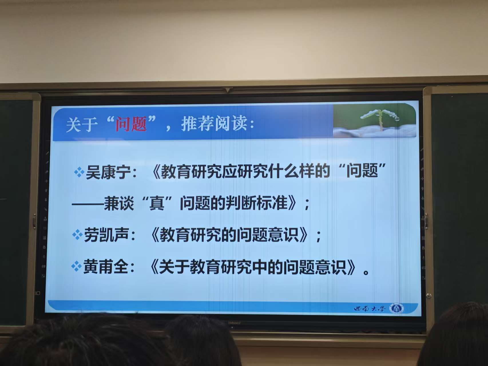
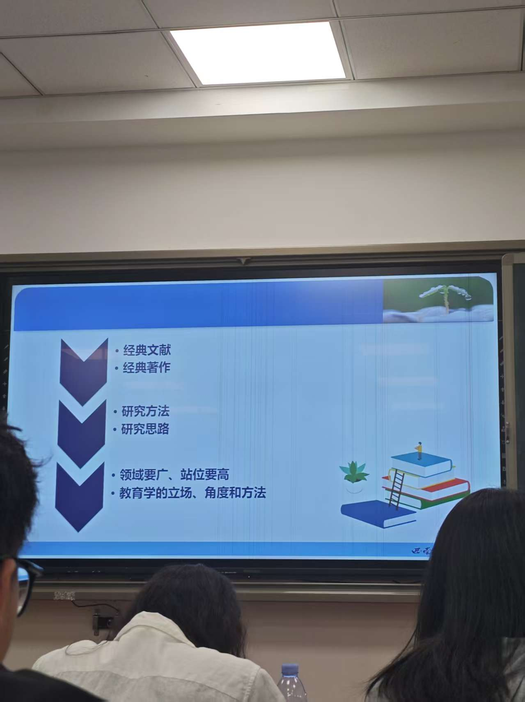
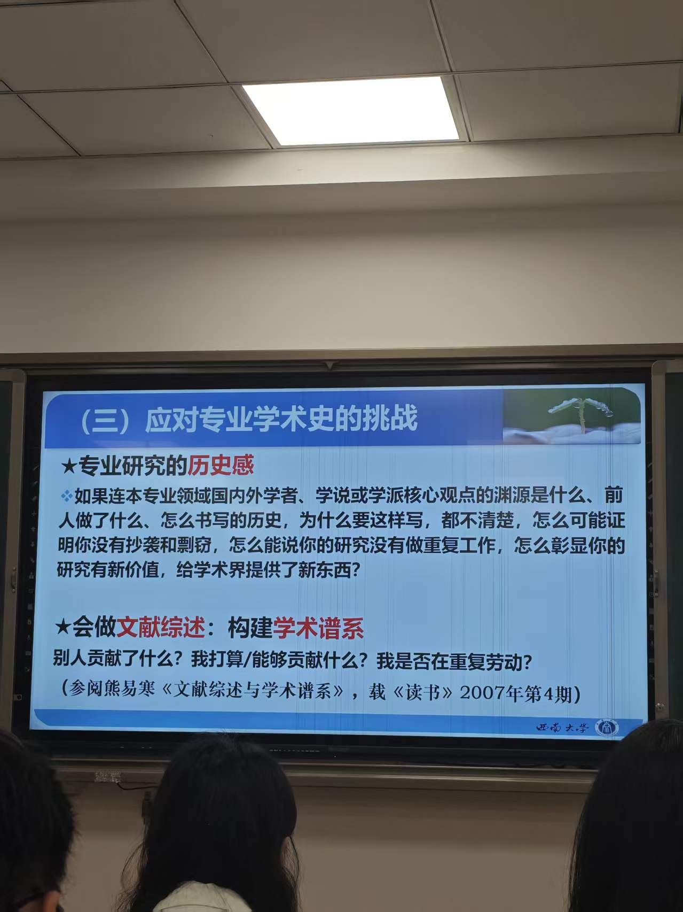
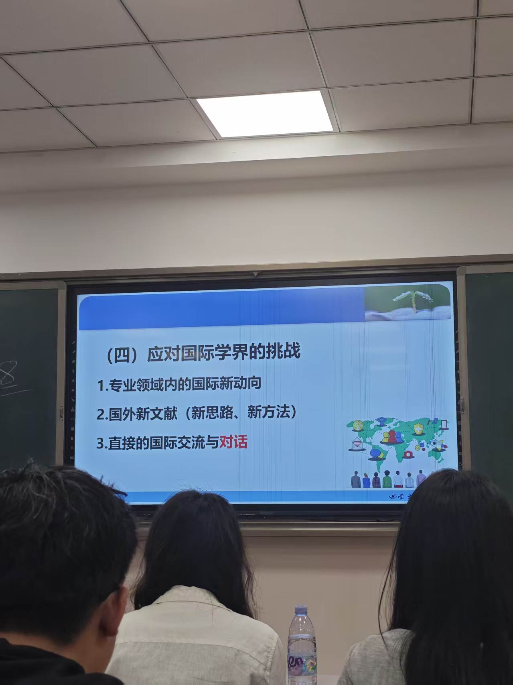
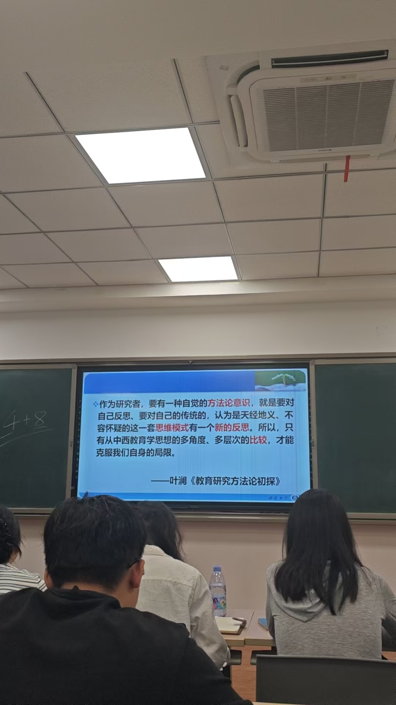

# 博士生的文献研究力：意义与方法

以《中国教育学发展世纪问题的审视》等系列论文为例

赵鑫 swuxinzhao@163.com 

2026.09.15

## 关注

1. 国家政策热点
2. 理论热点
3. 教育学经典理论 

## 论文写作

读文献逻辑、方法论（内容组织）

模仿

论文架构

内化

### 在文献阅读过程中，经验、困惑、堵点？

实证研究——方法 服务于目的和内容

视角创新，观点创新

要进行理论思辨  强化学理思辨、学理研究的深度和厚度

杜威、......理论著作

#### 博士生的研究视野：应该有多宽？

见山是山......见山还是山......见水还是水。

#### 导师、文献、专业学术史、国际学界：为什么要多管齐下？

#### 叶澜老师的文章：为什么选择？如何对话？我能学到什么？

究竟应该学点什么？

什么是“专业”？什么是“研究”？

1. 为什么要强调教师“专业”发展？（Professor&Profession）

   1. 教师专业性的标志：不可替代性（学科专业性、教育专业性）
   2. 教师任职必要的职业精神、职业道德、教育知识和教育能力等
   3. 掌握教育教学的基础知识和基本技能是提升高校教师专业水平的必要条件

2. 研究

   1. 赵宁宁 论文
   2. 学术：正确反应客观事物的系统知识，对存在物及其规律的学科化论证。——《现代汉语词典》
   3. 研究：深入地探求（问题）。——《新华字典》

   追求“高尚” （科学美）

3. 学术-研究

   1. 发现问题-分析问题-解决问题-发现问题 循环

      爱因斯坦：提出一个问题......

4. 推荐阅读

   1. 吴康宁
   2. 劳凯声
   3. 黄莆全

5. 研究什么？——围绕“问”题展开

   1. 常识 方法 视野
   2. 研读名家经典著作
      1. 领域要广
      2. 站位要高
      3. 教育学的立场、角度和方法
      4. 研究方法、研究思路

6. 发现经典文献、筛选专业文献、吸收文献思想

7. 专业研究的历史感：本专业领域国内外学者、学说或学派核心观点的渊源......

8. 会做文献综述：构建学术谱系

   1. 别人贡献了什么，我打算能够贡献什么，我是否在重复劳动
      1. 熊易寒《文献综述与学术谱系》

   

   

